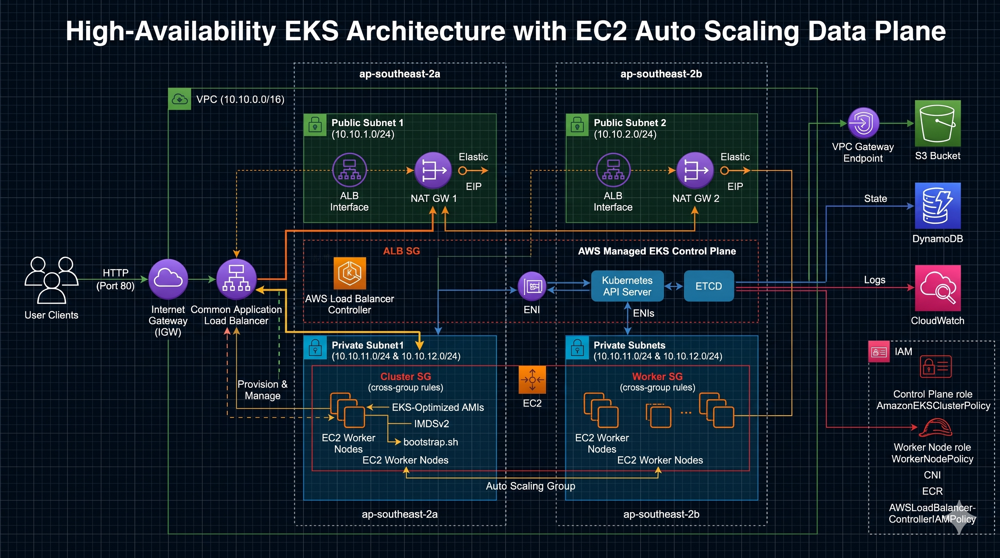

# AWS Multi-AZ EKS Infrastructure with GitOps & Argo CD (Zero-Touch)

An enterprise-grade, modular Infrastructure-as-Code (IaC) project built using **Terraform (HCL)** to provision a highly available, multi-AZ **Amazon Elastic Kubernetes Service (EKS 1.30)** cluster with self-managed EC2 worker nodes, automated **AWS Load Balancer Controller**, declarative **Argo CD** GitOps reconciliation, and zero-touch deployment of containerized workloads (2048 Game) using an automated, internet-facing Application Load Balancer.

---

## Architecture Diagram



---

## Architecture Overview

The infrastructure provisions a production-ready, highly available, and cost-optimized AWS environment:

- **Networking (VPC)**:
  - Custom VPC (`10.10.0.0/16`) spanning across **2 Availability Zones** (`ap-southeast-2a` and `ap-southeast-2b`).
  - **2 Public Subnets** tagged with `kubernetes.io/role/elb = 1` for public ALB auto-discovery.
  - **Dual NAT Gateways** (1 per AZ) ensuring full zone isolation and fault-tolerant outbound egress.
  - **2 Private Subnets** tagged with `kubernetes.io/role/internal-elb = 1` hosting the EC2 worker node data plane.
  - **VPC S3 Gateway Endpoint** for high-throughput, direct internal access to S3 container layers without incurring NAT Gateway data charges.
- **EKS Control Plane & Access Entries**:
  - Managed **Amazon EKS 1.30** cluster with private/public endpoint access and cluster security group.
  - Configured with `API_AND_CONFIG_MAP` authentication mode and automated `EC2_LINUX` EKS Access Entries for worker node registration.
- **Compute & Auto Scaling Data Plane**:
  - Self-managed **EC2 Worker Nodes** managed via an Auto Scaling Group (ASG) across private subnets.
  - EKS-optimized Amazon Linux 2 AMI with automated bootstrapping via `bootstrap.sh`.
  - Launch template configured with **IMDSv2 (`http_put_response_hop_limit = 2`)** to ensure pods can securely access instance metadata credentials.
  - Worker node IAM role configured with `AmazonEKSWorkerNodePolicy`, `AmazonEKS_CNI_Policy`, `AmazonEC2ContainerRegistryReadOnly`, and the official `AWSLoadBalancerControllerIAMPolicy`.
- **Addons & GitOps Reconciliation (Argo CD)**:
  - Automated deployment of the **AWS Load Balancer Controller** via Helm.
  - Automated deployment of **Argo CD** via Helm with native namespace management (`create_namespace = true`).
  - Declarative GitOps `Application` CRD tracking this GitHub repository, automatically syncing and reconciling `2048-game.yaml`.
  - Optimized resource lifecycle management: removed deadlocking finalizers for smooth, automated `terraform destroy` workflows.
  - Dynamic provisioning of an internet-facing **Application Load Balancer (ALB)** targeting pods directly via IP mode (`alb.ingress.kubernetes.io/target-type: ip`).
- **Regional Services**:
  - S3 bucket with default server-side encryption (AES256) and versioning.
  - DynamoDB state/lock table with point-in-time recovery.
  - CloudWatch metric alarms monitoring Auto Scaling Group CPU utilization.

---

## Repository Structure

```text
terraform-infra-eks-zero-touch/
├── Multi_Az_Eks_Architecture.png # High-Availability Architecture Diagram
├── 2048-game.yaml            # Multi-document Kubernetes manifest (NS, Deployment, SVC, Ingress)
├── .gitignore                # Excludes .terraform, *.pem, and .helm-cache
├── README.md                 # Project architecture and runbook documentation
├── modules/
│   ├── vpc/                  # Multi-AZ subnets, IGW, dual NAT GWs, S3 Gateway endpoint
│   │   ├── main.tf
│   │   ├── variables.tf
│   │   └── outputs.tf
│   ├── security/             # Security group rules for Control Plane, ALB, & Nodes
│   │   ├── main.tf
│   │   ├── variables.tf
│   │   └── outputs.tf
│   ├── eks/                  # EKS 1.30 control plane, IAM cluster roles, access entries
│   │   ├── main.tf
│   │   ├── variables.tf
│   │   └── outputs.tf
│   ├── asg/                  # EC2 launch templates (IMDSv2 hop=2), worker IAM, and ASG
│   │   ├── main.tf
│   │   ├── variables.tf
│   │   └── outputs.tf
│   ├── addons/               # Helm releases (AWS LB Controller, Argo CD) & GitOps Application CRD
│   │   ├── main.tf
│   │   ├── variables.tf
│   │   └── outputs.tf
│   └── regional_services/    # S3 bucket, DynamoDB table, CloudWatch metric alarms
│       ├── main.tf
│       ├── variables.tf
│       └── outputs.tf
└── environments/
    └── dev/                  # Development environment deployment root
        ├── backend.tf        # Remote state backend configuration
        ├── main.tf           # Root module with AWS CLI exec provider authentication
        ├── variables.tf      # Environment input definitions
        ├── terraform.tfvars  # Target region, CIDRs, AZs, and instance sizing
        └── outputs.tf        # Cluster endpoint, kubeconfig command, application access info
```

---

## 🔒 Security & Key Management

- **Dynamic Key Generation (`aws_login`)**:
  - Generates a 4096-bit RSA key pair during execution using the `tls` and `local` providers.
  - Saves `aws_login_dev.pem` directly to the execution directory with restrictive file permissions (`0400`), remaining uncommitted to version control.
- **IMDSv2 Pod Compatibility**:
  - The EC2 launch template sets `http_put_response_hop_limit = 2`, enabling pods running on worker nodes to reach instance metadata endpoints for credential retrieval without compromising node security.
- **Least-Privilege Security Group Cross-Rules**:
  - Nodes permit direct worker-to-worker communication for pod overlay networks.
  - Bi-directional security group rules open port 443 and kubelet ports (10250–65535) exclusively between the EKS Control Plane ENI and the worker node security group.

---

## Prerequisites

- **Terraform**: CLI `>= 1.5.0` installed
- **AWS CLI**: Configured with credentials and the targeted IAM profile:
  ```bash
  aws configure --profile terraform
  ```
- **kubectl**: CLI installed locally for cluster inspection

---

## Deployment Instructions

### 1. Initialize and Deploy

Navigate to the `dev` environment directory, initialize the providers, and execute the deployment:

```bash
cd environments/dev
terraform init
terraform apply -auto-approve
```

Terraform provisions the complete multi-AZ VPC, launches the EKS cluster, registers the self-managed EC2 nodes, installs the AWS Load Balancer Controller and Argo CD, and applies the GitOps Application CRD.

### 2. Configure Local Kubeconfig

Run the helper command from the Terraform outputs to connect your local `kubectl`:

```bash
aws eks update-kubeconfig --region ap-southeast-2 --name dev-eks-cluster --profile terraform
```

### 3. Verify Nodes, Addons, and GitOps Sync

```bash
# Verify worker nodes are Ready
kubectl get nodes

# Verify AWS Load Balancer Controller is running
kubectl get pods -n kube-system -l app.kubernetes.io/name=aws-load-balancer-controller

# Verify Argo CD pods are healthy
kubectl get pods -n argocd

# Verify Argo CD has synced the game-2048 application
kubectl get applications -n argocd
```

### 4. Access Argo CD Web UI

Forward the Argo CD server to your local machine:

```bash
kubectl port-forward svc/argo-cd-argocd-server -n argocd 8080:443
```

Retrieve the default `admin` password:

- **PowerShell:**
  ```powershell
  [System.Text.Encoding]::UTF8.GetString([System.Convert]::FromBase64String((kubectl -n argocd get secret argocd-initial-admin-secret -o jsonpath="{.data.password}")))
  ```
- **Git Bash / Linux / macOS:**
  ```bash
  kubectl -n argocd get secret argocd-initial-admin-secret -o jsonpath="{.data.password}" | base64 -d
  ```

Open **`https://localhost:8080`** in your browser and log in with username `admin`.

### 5. Access the Application

Retrieve the automatically provisioned Application Load Balancer address:

```bash
kubectl get ingress ingress-2048 -n game-2048
```

Open the address (`http://k8s-game2048-ingress2-xxxxxx.ap-southeast-2.elb.amazonaws.com`) in your browser to interact with the live application.

---

## Teardown & Clean Destruction

To destroy the entire infrastructure without orphaned resources or hanging finalizers:

```bash
cd environments/dev
terraform destroy -auto-approve
```

### Post-Teardown Verification

Verify that all external resources, load balancers, and Elastic IPs have been cleanly decommissioned:

```bash
# Confirm no running EC2 worker nodes
aws ec2 describe-instances --region ap-southeast-2 --profile terraform --filters "Name=instance-state-name,Values=running" --query "Reservations[*].Instances[*].InstanceId"

# Confirm no lingering ALBs or Target Groups
aws elbv2 describe-load-balancers --region ap-southeast-2 --profile terraform --query "LoadBalancers[*].LoadBalancerArn"
aws elbv2 describe-target-groups --region ap-southeast-2 --profile terraform --query "TargetGroups[*].TargetGroupArn"

# Confirm no unattached Elastic IPs
aws ec2 describe-addresses --region ap-southeast-2 --profile terraform --query "Addresses[*].PublicIp"

# Confirm EKS cluster is removed
aws eks list-clusters --region ap-southeast-2 --profile terraform
```

---

## 👤 Author

**Manish D** — Platform & DevOps Engineer  
LinkedIn: [linkedin.com/in/manish-d-0779b01aa](https://www.linkedin.com/in/manish-d-0779b01aa)